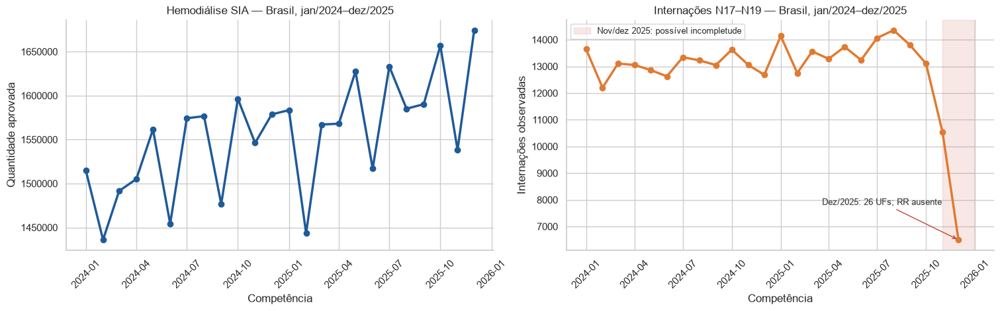
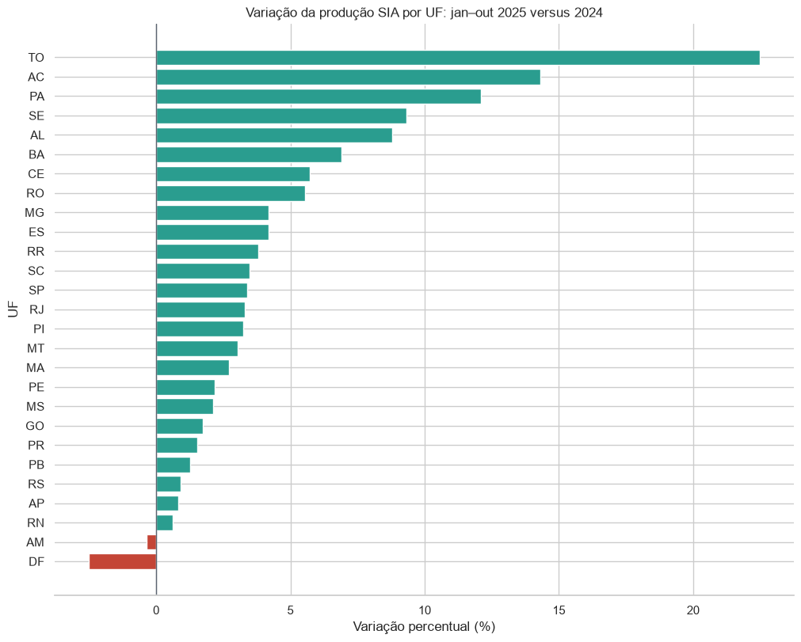
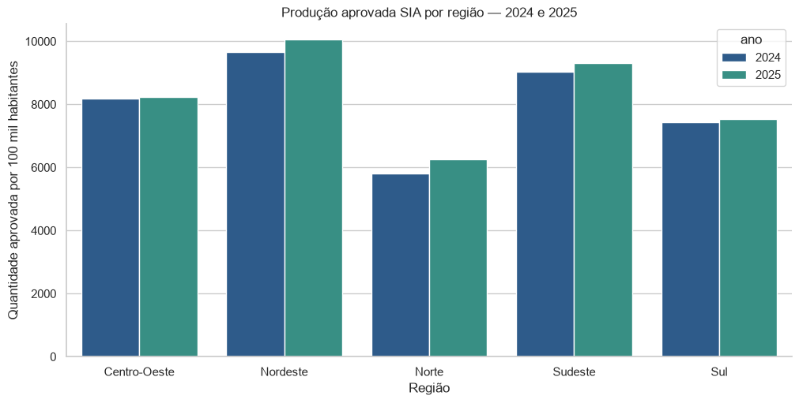
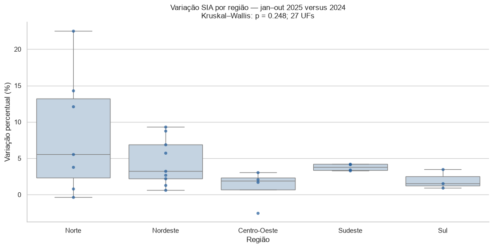
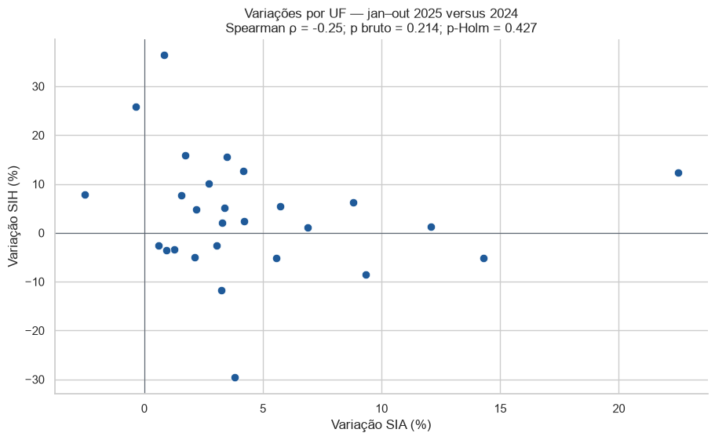
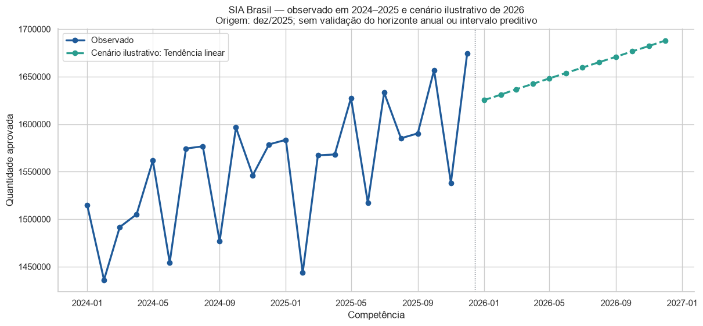

# Produção aprovada de hemodiálise e internações por insuficiência renal no SUS: análise territorial de 2024–2025

Relatório final do trabalho de Estatística Aplicada à Análise de Dados. Versão editorial: 15/11/2026.

## Resumo

O estudo descreve a produção aprovada de hemodiálise no SIA/SUS e as internações N17–N19 no SIH/TabNet, utilizando população anual IBGE para contextualização territorial. O painel contém 648 combinações UF-mês de 2024–2025; a comparação principal usa janeiro–outubro de ambos os anos, em 27 UFs. A produção SIA aumentou de 15.187.201 para 15.772.215 (+3,85%) e as internações SIH de 130.752 para 136.036 (+4,04%). O aumento ocorreu em 25 UFs para SIA e 17 para SIH. A associação entre variações estaduais não apresentou evidência suficiente após ajuste de Holm (Spearman ρ = −0,247; p ajustado = 0,427); a comparação regional SIA também não (Kruskal–Wallis p = 0,248). Entre três regras simples de previsão, a tendência linear apresentou menor MAPE retrospectivo (3,01%) em 12 previsões de um mês à frente de 2025. Os resultados dimensionam volumes e contrastes territoriais da extração disponível; não estimam pessoas únicas, prevalência de DRC ou efetividade do tratamento.

## 1. Problema e objetivo

**Pergunta central:** como a produção aprovada de hemodiálise e as internações por insuficiência renal se distribuíram e variaram entre UFs, regiões e períodos comparáveis de 2024–2025?

O objetivo é quantificar magnitude, direção e heterogeneidade dessas mudanças, comparar a intensidade bruta de produção SIA por população, explorar associações territoriais e avaliar retrospectivamente regras simples de previsão. A estatística descritiva constitui a resposta principal; inferência e previsão têm caráter exploratório.

O nome histórico dos arquivos contém “DRC”, mas o indicador hospitalar N17–N19 abrange insuficiência renal aguda, crônica e não especificada. O objeto deste relatório é o registro administrativo desses serviços e internações, sem pretensão de medir a carga específica da doença renal crônica.

## 2. Dados e desenho

Trata-se de estudo ecológico descritivo com comparações temporais. A base é o [painel UF-mês](Dados/03_bases_analiticas/descritiva_territorial_2024_2025/painel_descritivo_uf_mes_2024_2025.csv) já integrado e auditado nos notebooks 01–04. O [notebook 09](Notebook/09_ANALISE_ESTATISTICA_E_PREVISAO_DRC.ipynb) implementa a análise final.

| Fonte | Medida e recorte | Uso e limitação |
|---|---|---|
| SIA/SUS | Quantidade aprovada de procedimentos de hemodiálise, UF e competência, 2024–2025 | Produção administrativa; não equivale a pessoas ou sessões individuais confirmadas. |
| SIH/TabNet | Internações N17–N19, UF e mês de atendimento, 2024–2025 | Internações registradas; transferências/reinternações impedem interpretar o total como pessoas únicas. |
| IBGE | População anual por UF, referência em julho de 2024 e 2025 | Denominador para intensidade anual de produção; não foi convertido em denominador mensal. |

A extração SIA usa local de atendimento/processamento e o SIH usa local de internação/mês de atendimento, conforme o mapeamento e as notas das fontes. As séries não são eventos individuais vinculados nem representam necessariamente o mesmo momento clínico. A geografia de atendimento também não identifica residência ou cobertura assistencial dos moradores.

A presença de registros em todas as competências SIA comprova cobertura estrutural da extração, sem demonstrar encerramento administrativo ou ausência de revisões. APAC e microdados N18 ficam excluídos pelos critérios de auditoria já documentados. CNES e dados municipais são apenas materiais complementares.

## 3. Qualidade e métodos

### 3.1 Cobertura e janela comparativa

Foram conferidas 648 linhas, 27 UFs, 24 competências, ausência de duplicação das chaves UF-ano-mês e contagens observadas não negativas. Há 647 células SIH preenchidas e uma ausência em RR/dezembro de 2025. A cobertura de células preenchidas não garante maturidade do registro.

Novembro e dezembro de 2025 apresentam quedas SIH amplas frente a 2024. Sem nova extração ou confirmação técnica, esses meses ficam fora das comparações principais desta versão. A janela janeiro–outubro contém 540 linhas UF-mês e gera uma comparação pareada de 27 UFs. A previsão utiliza 24 totais nacionais mensais; os testes estaduais não tratam as 648 linhas como observações independentes.

A célula ausente permanece ausente na análise principal. Uma cópia de sensibilidade usa dezembro de 2024 de RR multiplicado pela razão dos totais RR janeiro–outubro de 2025 e 2024. O resultado arredondado é 27; trata-se de hipótese de imputação, sem validação externa, e não de recuperação do valor real.

### 3.2 Descrição e probabilidade empírica

Foram calculados resumo numérico, totais, diferenças absolutas e percentuais, rankings e proporções de UFs com aumento. A variação nacional usa a razão dos totais, enquanto a frequência de aumento atribui o mesmo peso a cada UF. A taxa anual SIA por 100 mil habitantes usa a produção de janeiro a dezembro e a população do mesmo ano; a taxa regional é a razão das somas, não a média simples das taxas estaduais.

A probabilidade empírica refere-se à escolha uniforme de uma UF entre as 27 observadas. Seu valor é uma proporção conhecida neste conjunto. Os intervalos binomiais exatos de 95% são exercícios condicionados ao modelo de referência, não erros amostrais de um censo territorial.

### 3.3 Testes exploratórios e comparação regional

Foram aplicados testes binomiais bilaterais de sinais para SIA e SIH e correlação de Spearman entre as variações percentuais estaduais. A família de Holm contém esses três testes, ao nível exploratório de 5%. O p-valor de Spearman é o retornado por `scipy.stats.spearmanr`. A síntese anterior do notebook 04 utilizou cinco testes e correlação por permutação; seus p-valores ajustados não devem ser substituídos pelos desta família nem combinados com eles.

A comparação regional usa uma variação SIA por UF. Shapiro–Wilk por região e Levene com centro na mediana orientam a avaliação didática de ANOVA. Diante de Levene p = 0,037, a leitura complementar usa Kruskal–Wallis. Esse teste compara distribuições por postos e não isola medianas quando as dispersões diferem. Seus resultados são apresentados separadamente da família de três testes, sem afirmar controle global de multiplicidade para todas as análises do projeto. Os grupos são pequenos (Sul: 3 UFs; Centro-Oeste: 4), e não rejeitar normalidade não comprova o pressuposto. Dependência espacial e fatores territoriais não observados limitam todos os testes.

### 3.4 Comparação preditiva retrospectiva

Comparam-se média móvel dos três meses anteriores, tendência linear por mínimos quadrados e ingênuo sazonal (mesmo mês do ano anterior). Para cada mês de 2025, o histórico contém somente meses anteriores. São 12 previsões de um mês à frente, com janela de treinamento crescente. Seleciona-se menor MAPE; em empate, menor MAE. RMSE complementa a avaliação.

Os modelos são selecionados e avaliados na mesma janela, sem teste final independente. O cenário de 2026 parte de dezembro de 2025 e não tem observações futuras nesta base para avaliação. Ele não é uma previsão atualizada em novembro de 2026, nem tem erro anual validado ou intervalo preditivo calibrado.

## 4. Resultados

### 4.1 Magnitude nacional e distribuição territorial

| Indicador, janeiro–outubro | 2024 | 2025 | Diferença | Variação |
|---|---:|---:|---:|---:|
| Quantidade aprovada SIA | 15.187.201 | 15.772.215 | +585.014 | +3,85% |
| Internações SIH N17–N19 | 130.752 | 136.036 | +5.284 | +4,04% |

O SIA aumentou em 25 UFs e diminuiu em 2. A variação mediana estadual foi +3,30%; os extremos foram DF (−2,52%) e TO (+22,49%). O SIH aumentou em 17 UFs e diminuiu em 10, com mediana de +2,38%; os extremos foram RR (−29,60%) e AP (+36,39%). Percentuais extremos em bases pequenas não implicam maior contribuição absoluta para o total nacional. As tabelas completas incluem as duas medidas para as 27 UFs.

*Figura 1. Totais mensais observados. O destaque SIH sinaliza possível incompletude em novembro/dezembro de 2025; dezembro contém 26 UFs e exclui RR ausente. A queda observada não tem causa identificada.*

*Figura 2. Variação percentual da produção SIA em janeiro–outubro de 2025 frente ao mesmo período de 2024. O ranking descreve mudanças, sem avaliar desempenho assistencial.*

### 4.2 Produção anual por população e comparação regional

| Região | Quantidade aprovada SIA por 100 mil — 2024 | Quantidade aprovada SIA por 100 mil — 2025 |
|---|---:|---:|
| Centro-Oeste | 8.172,2 | 8.225,8 |
| Nordeste | 9.670,7 | 10.060,9 |
| Norte | 5.799,4 | 6.259,8 |
| Sudeste | 9.024,7 | 9.314,5 |
| Sul | 7.436,0 | 7.527,5 |

O Nordeste apresentou a maior intensidade bruta de produção nos dois anos; o Norte, a menor. Todas as regiões apresentaram aumento desse indicador na extração. Essas diferenças não são ajustadas por idade, necessidade clínica, fluxos de pacientes ou composição dos serviços e não demonstram cobertura ou acesso.

*Figura 3. Produção anual de janeiro a dezembro de cada ano dividida pela população IBGE do mesmo ano. A unidade difere da variação janeiro–outubro usada na comparação regional abaixo.*

*Figura 4. Cada ponto corresponde a uma UF; as caixas resumem a distribuição da variação janeiro–outubro. Kruskal–Wallis p = 0,248: evidência insuficiente de diferença regional, sem demonstrar igualdade. O valor é complementar e não ajustado por Holm.*

### 4.3 Frequências, testes e associação

| Indicador | UFs com aumento | Proporção observada | IC binomial exato de referência, 95% |
|---|---:|---:|---:|
| SIA | 25/27 | 92,6% | 75,7%–99,1% |
| SIH | 17/27 | 63,0% | 42,4%–80,6% |

| Teste da família do notebook 09 | Estatística/contagem | p bruto | p-Holm |
|---|---|---:|---:|
| Sinais SIA | 25 aumentos e 2 reduções | 0,00000565 | 0,00001694 |
| Sinais SIH | 17 aumentos e 10 reduções | 0,247789 | 0,427452 |
| Spearman das variações | ρ = −0,247253 | 0,213726 | 0,427452 |

O predomínio direcional de aumento SIA é incompatível com a referência de 50% sob o modelo binomial utilizado. Para SIH não há evidência suficiente contra esse equilíbrio. A correlação negativa observada não permite concluir associação protetora, independência ou efeito da produção de hemodiálise sobre internações.

*Figura 5. As duas coordenadas de cada ponto pertencem à mesma UF, na janela janeiro–outubro. O gráfico apresenta coeficiente de Spearman e p-valores bruto e ajustado da família de três testes.*

### 4.4 Sensibilidade da ausência SIH

O fator RR janeiro–outubro foi 0,704; a imputação de dezembro de 2025 foi 27. O total observado SIH de 2025 é 153.083 e a soma com a imputação seria 153.110. A pequena mudança de 27 registros mostra apenas o impacto dessa célula sob a regra proposta. Ela não corrige a possível incompletude dos demais registros de novembro/dezembro e não autoriza utilizar o total anual como resultado completo. Os testes principais não mudam, pois utilizam janeiro–outubro.

### 4.5 Desempenho preditivo e cenário ilustrativo

| Modelo | MAE (quantidade aprovada) | RMSE (quantidade aprovada) | MAPE |
|---|---:|---:|---:|
| Tendência linear | 46.849 | 62.453 | 3,01% |
| Média móvel (3 meses) | 55.276 | 65.864 | 3,53% |
| Ingênuo sazonal | 57.400 | 65.882 | 3,59% |

A tendência linear apresentou o menor MAPE entre os candidatos. A diferença entre os modelos é pequena em termos absolutos de MAPE e não foi submetida a teste formal de superioridade. O valor de 3,01% descreve erros retrospectivos de um mês à frente na extração utilizada; não mede toda a incerteza administrativa nem a precisão de 12 meses projetados.

*Figura 6. Observado de janeiro de 2024 a dezembro de 2025 e extrapolação de tendência para 2026. Não há validação do horizonte anual ou intervalo preditivo. A ausência de faixa não significa certeza.*

## 5. Discussão e limites

O crescimento nacional SIA ocorreu com aumento em quase todas as UFs, enquanto o SIH apresentou maior heterogeneidade direcional. Assim, crescimento total e disseminação territorial respondem a perguntas diferentes e devem ser apresentados juntos. Os contrastes populacionais brutos contextualizam os volumes, mas não permitem julgar a suficiência da oferta ou a qualidade do cuidado.

A falta de evidência suficiente nas associações e na comparação regional não é um resultado vazio: delimita o que esta análise não conseguiu distinguir com 27 unidades territoriais e estes métodos. Não há base para concluir equivalência entre regiões, ausência de relação clínica ou efeito terapêutico.

Os limites incluem qualidade e revisões dos registros administrativos, uma ausência SIH, possível incompletude no fim de 2025, escolha da janela após identificar esse problema, diferenças de temporalidade entre sistemas, ausência de padronização etária e de ajuste por confundidores, dependência espacial e série curta. Os intervalos e testes são exploratórios, não uma confirmação independente de hipóteses previamente registradas. APAC e N18 não entram na análise para evitar inferências sem suporte técnico. Não foram acrescentados testes para buscar significância.

## 6. Conclusão

Com as fontes disponíveis, o estudo quantifica crescimento de produção SIA e internações N17–N19 em períodos comparáveis, descreve sua distribuição territorial e identifica a maior disseminação direcional do aumento SIA. Não encontrou evidência suficiente de associação monotônica entre mudanças estaduais ou de diferença regional da variação SIA. A tendência linear foi o melhor dos três candidatos na avaliação retrospectiva de um mês à frente, com alcance exploratório.

A entrega estatística está restrita a esses resultados observáveis e aos limites explicitados. Não estima pacientes únicos, incidência/prevalência de DRC, necessidade não atendida, causalidade, sobrevida ou demanda operacional futura. Novas extrações e esclarecimentos técnicos são possibilidades para outro ciclo de pesquisa; a conclusão deste estudo não depende deles.

## 7. Reprodutibilidade e materiais da entrega

- [Notebook 09 executado](Notebook/09_ANALISE_ESTATISTICA_E_PREVISAO_DRC.ipynb), com contadores sequenciais e saídas salvas.
- [Versão HTML do notebook](Dados/03_bases_analiticas/analise_estatistica_final_2024_2025/notebook_09_executado.html).
- [Artefatos finais e instruções](Dados/03_bases_analiticas/analise_estatistica_final_2024_2025/LEIA-ME.md): nove tabelas CSV, seis figuras PNG e registro do ambiente.
- [Registro de execução JSON](Dados/03_bases_analiticas/analise_estatistica_final_2024_2025/registro_execucao.json): Python 3.12.13, versões dos pacotes, identificação da base e data de execução.
- [Registro de fechamento e revisão visual](Dados/04_documentacao_e_auditoria/REGISTRO_FECHAMENTO_ESTATISTICO_2026-11-15.md).

SHA-256 do painel utilizado: `5d8f671d31c7b83aa4e1e20c1221731e941957ed32e6f756c10a5e1a5e2d91a4`. A base foi verificada antes e depois da execução e permaneceu idêntica. As figuras deste relatório provêm das saídas da execução Jupyter, sem recomputação independente dos valores.

## 8. Referências e proveniência documental

As referências das fontes abaixo já integram a [bibliografia do projeto](referencias_bibliograficas_doenca_renal_cronica_sus.md), com datas de acesso registradas. Este fechamento utiliza as cópias e notas locais; não realizou nova extração ou consulta para atualizar as fontes.

1. Ministério da Saúde, DATASUS. SIA/SUS: produção ambulatorial e notas técnicas. Filtros locais em [mapeamento da hemodiálise](mapeamento_hemodialise_sia_sus.md).
2. Ministério da Saúde, DATASUS. SIH/SUS: morbidade hospitalar por local de internação, categoria N17–N19. Critérios na [nota da base territorial](Dados/04_documentacao_e_auditoria/LEIA-ME_BASE_DESCRITIVA_TERRITORIAL_2024_2025.md).
3. IBGE. Estimativas da população residente por UF, referência em 1º de julho de 2024 e de 2025, nas edições identificadas na bibliografia.
4. Documentação metodológica local: [plano estatístico](plano_analise_estatistica_e_previsao_drc.md), notebook 09 e [registro de limitações da auditoria](Dados/04_documentacao_e_auditoria/PENDENCIAS_EXTERNAS_E_METODOLOGICAS_2026-11-15.md).
